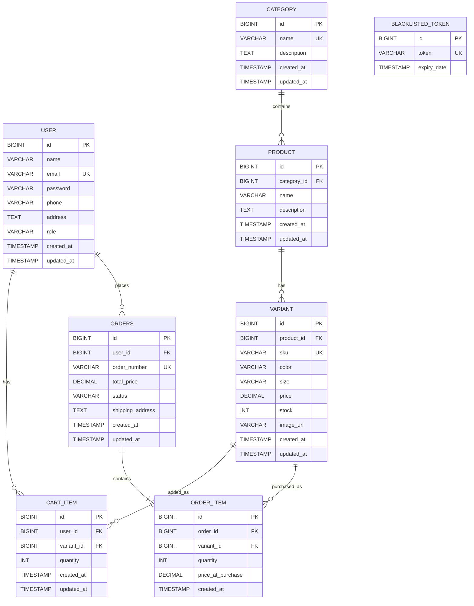

DATABASE DESIGN


CLASS DESIGN
```mermaid
```

ARCHITECTURE DESIGN
```mermaid
```

API VISUALIZATION
```
Authentication:
POST    /api/auth/register
POST    /api/auth/login
POST    /api/auth/logout

User Profile:
GET     /api/users/me
PUT     /api/users/me
PUT     /api/users/me/password

Product Catalog:
GET     /api/products
GET     /api/products/{id}
GET     /api/products?keyword=value

Product Management:
POST    /api/admin/products
PUT     /api/admin/products/{id}
DELETE  /api/admin/products/{id}

Category Management:
GET     /api/categories
POST    /api/admin/categories
PUT     /api/admin/categories/{id}
DELETE  /api/admin/categories/{id}

Shopping Cart:
GET     /api/cart
POST    /api/cart/items
PUT     /api/cart/items/{id}
DELETE  /api/cart/items/{id}

Checkout:
POST    /api/orders/checkout

Orders:
GET     /api/orders
GET     /api/orders/{id}

Order Management:
GET     /api/admin/orders
GET     /api/admin/orders/{id}
PUT     /api/admin/orders/{id}/status
```